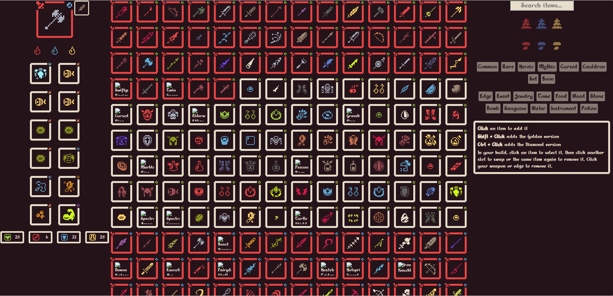

# He Is Coming Build Planner

A free, fan-made build planner for the auto-battler **He Is Coming**. Pick a weapon, an edge and up to 12 items, and the planner shows your final Health / Attack / Armor / Speed, including item effects that change stats, active item sets, and Golden / Diamond versions of common items.

It's plain HTML, CSS and JavaScript. There is nothing to install and no build step.

> **Unofficial.** This project is not affiliated with, endorsed by, or connected to the developers or publisher of He Is Coming. It is free and non-commercial. See [Disclaimer](#disclaimer).


## Features

- **Item selector** with search, region bundle filters, rarity filters and tag filters. Items are sorted the way the game sorts them: by rarity, weapons before items, then alphabetically.
- **Build panel** with a weapon slot, an edge slot, three weapon oils (toggle them on or off) and 12 item slots.
- **Live stat calculation**, including items whose stats depend on your build (per-tag bonuses, per-empty-slot bonuses, conditional bonuses, base-stat effects, stat copying and more. Does not include stat changes or other effects that would occur after battle start).
- **Item sets** that activate automatically, with their bonuses applied. Weapon modifications count as holding their parent weapons.
- **Golden and Diamond items:** Shift + Click adds the Golden version of a common item, Ctrl + Click adds the Diamond version. Stats and descriptions update to match.
- **Tooltips** for everything in the picker and in your build.

## How to use it

- **Click** an item in the picker to add it to your build.
- **Shift + Click** adds the Golden version, **Ctrl + Click** adds the Diamond version (common items only).
- In your build, click an item to select it, then click another slot to swap, or click the same item again to remove it.
- Click the weapon slot to reset to the Wooden Stick. Click the edge slot to remove the edge.
- Click an oil to toggle it.

## Running it locally

The page loads its data with `fetch()`, which browsers block when you open an HTML file directly from disk. Serve the folder with any static server:

- **VS Code:** install the *Live Server* extension, then right-click `index.html` and choose *Open with Live Server*.
- **Python:** run `python -m http.server 8000` in this folder and open <http://localhost:8000>.
- **Node:** run `npx serve` in this folder.

## Project layout

```
index.html        page structure
style.css         styling
script.js         all app logic (build state, stat calculation, filters, tooltips)
data/
  weapons.json    weapons
  items.json      items (including goldImage / diamondImage and tier descriptions)
  edges.json      edges
  sets.json       item sets and their bonuses
  boons.json      boons (not used by the UI yet)
assets/           images and fonts
```

Items that change stats based on your build use a small `dynamicEffect` object in the JSON (for example `perTag`, `addIf`, `multiply`, `copyStat`, `negate`). `script.js` evaluates these in the same order the game does: weapon, edge, items from left to right and top to bottom, then sets, with "always" effects applied last.

## Known limitations

- **Effects that trigger after battle start are not simulated.** Only stats you can see before a fight are calculated, so effects like "Battle Start: Gain 3 armor" are shown in tooltips but not added to the totals.
- Bearclaw's special effect is not implemented.
- Boons are in the data but not in the UI yet.
- Builds can't be saved or shared yet.
- Golden and Diamond descriptions are generated by doubling the amounts in the normal description. Durations and counters are left alone. This may not match the game for every item.
- Some items have no artwork linked yet, so they show a blank image and can't be made Golden or Diamond.
- Some tag codes from the game data have not been identified, so those tags don't appear. 

## Contributing

Corrections are welcome, especially to the data. Open an issue or a pull request if a stat, description, set or interaction doesn't match the game.

## Disclaimer

He Is Coming, its name, artwork, icons, UI graphics, item names and descriptions, and game data are the property of their respective owners. They appear here for the sole purpose of building a free, non-commercial reference tool for the game's community, and no ownership of them is claimed. If you are a rights holder and would like something changed or removed, please open an issue and it will be taken care of promptly.

## License

The code in this repository (`index.html`, `script.js`, `style.css`) is released under the [MIT License](LICENSE). Use it, change it, or build on it however you like.

**The MIT license does not cover any game material** (artwork, icons, UI graphics, names, descriptions or game data). Those remain the property of their owners. If you fork this project for anything beyond personal use, replace or remove them.

The *Alkhemikal* font in `assets/fonts` is used as the page font. It is distributed under its own license, not this project's.
